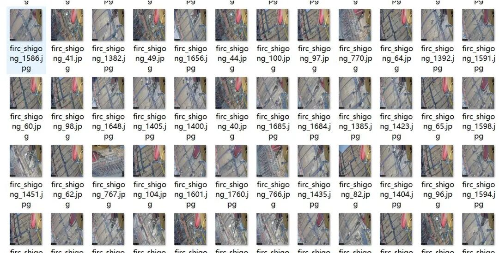
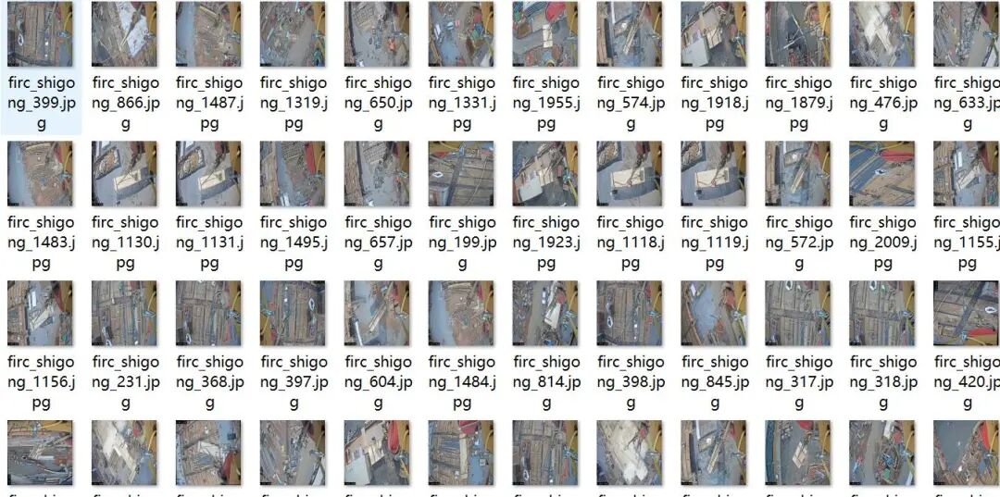
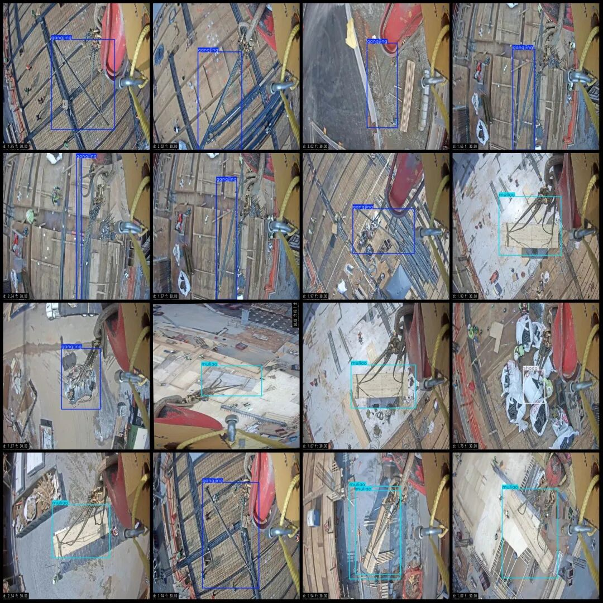
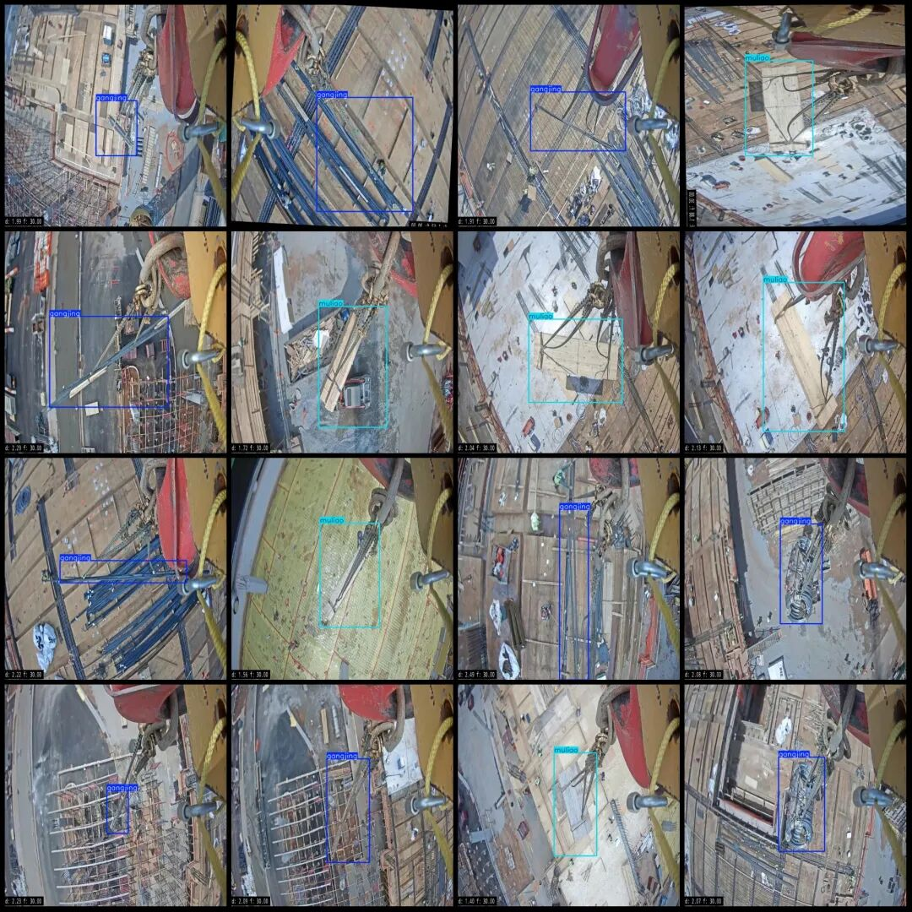

# Intelligent Industrial Construction Site Dataset: Crane-Elevated Material Objects, Plywood, Wood, Rebar, Sandbag Inspection Data Set in VOC+YOLO format with 2011 categories.

Dataset format: Pascal VOC format + YOLO format (txt file without split path, only containing jpg images and corresponding VOC format xml files and yolo format txt files)

Number of images (number of jpg files): 2011

Number of annotations (number of xml files): 2011

Number of annotations (number of txt files): 2011

Labeling category count: 4

Label category names (note that the order of categories in the YOLO format does not correspond to this, but is based on the labels folder's classes.txt): ["bancai", "gangjing", "muliao", "shadai"]

Number of boxes labeled in each category:

bancai (sheet) frame count = 99

Gangjing (rebar) Frame Count = 1131

Muliao (wood) Frame Count = 796

shadai (shad) frame count = 18

Total frames: 2044

Image resolution: 640x640

Using labelImg:

Annotation rules: Draw a rectangle around the category.

Important Notice: No

Is the dataset enhanced? A small number of enhanced images mainly consist of rotation enhancements.

Special : This dataset does not guarantee the accuracy of the trained models or weight files.

Image Preview:

Annotation example:

## Payment

Here is a pay link on Stripe ( https://buy.stripe.com/3cs8yP7sY87d0vu9AB ). Please contact me lonlonago@foxmail.com after funding $89, and I will send you a complete data files , thank you!

